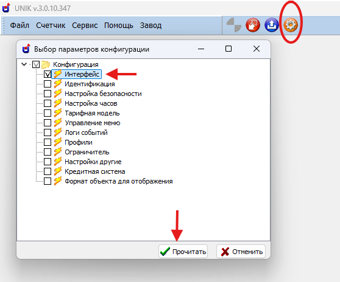
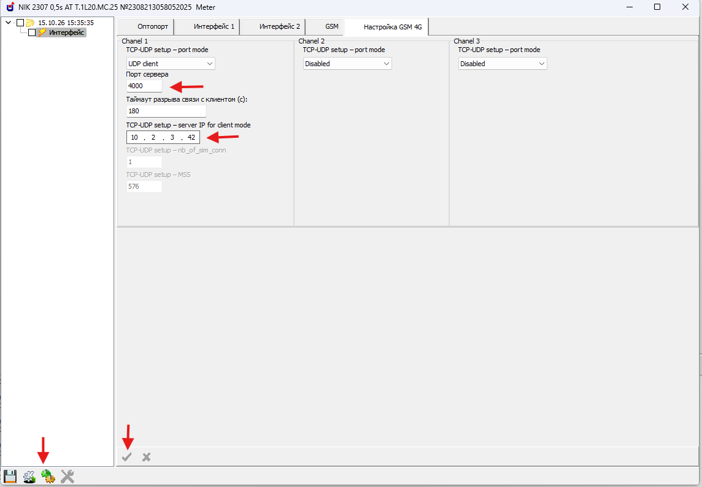

# Сервіс NIK DLMS Push

Сервіс для надсилання push-сповіщень на мобільні пристрої через застосунок **NIK BT-DLMS**. Забезпечує обробку подій від лічильників НІК та інформування користувачів про стан і роботу приладів.

**Мобільний застосунок NIK BT-DLMS:**

- [Android — Google Play](https://play.google.com/store/apps/details?id=com.nik.bt.dlms&hl=uk)
- [iOS — App Store](https://apps.apple.com/ua/app/nik-bt-dlms/id6783743210?l=uk)

**Працює також на Windows:** установіть Docker Desktop із підтримкою Linux-контейнерів. Установлювати Python, PostgreSQL або Redis безпосередньо у Windows не потрібно — вони працюють у контейнерах.

> Поточна версія призначена для довіреної локальної мережі або VPN. Авторизацію REST API та WebSocket ще не реалізовано. Не відкривайте їх у загальний доступ до інтернету. HTTPS шифрує з’єднання, але не замінює перевірку прав доступу.

## Як це працює

```text
Лічильник → UDP-повідомлення → DLMS Push → PostgreSQL
                                  ↓
                         REST API та WebSocket
                                  ↓
                         Мобільний застосунок
```

- Лічильник сам надсилає повідомлення за налаштованим розкладом або подією. Сервіс не опитує його безпосередньо.
- REST API дає застосунку список лічильників, показання та історію. WebSocket повідомляє про нові дані під час підключення.
- Нові показання з’являються після надходження push від лічильника. Це не безперервне вимірювання в реальному часі.
- UDP не гарантує доставку. Сервіс не може відновити пакет, який до нього не надійшов.
- Застосунок отримує нові показання, поки підтримує з’єднання із сервісом. Після повернення до застосунку завантажуються показання, отримані сервером за час відсутності з’єднання.

## Де можна запустити

| Середовище | Що встановити |
|---|---|
| Windows | Docker Desktop, налаштований на Linux-контейнери, наприклад із WSL 2 |
| Linux | Docker Engine і модуль Docker Compose |
| macOS | Docker Desktop |

Для Windows використовуйте версію ОС, яку підтримує поточний Docker Desktop. Docker Desktop не підтримується на Windows Server; для такого середовища потрібне окремо підготовлене Linux-середовище, наприклад віртуальна машина.

Офіційні інструкції Docker: [Windows](https://docs.docker.com/desktop/setup/install/windows-install/), [WSL 2](https://docs.docker.com/desktop/features/wsl/), [обмеження Windows Server](https://docs.docker.com/desktop/troubleshoot-and-support/faqs/windowsfaqs/).

Потрібні вільне місце для бази та мережевий доступ від лічильника і телефона до комп’ютера із сервісом. Ресурси залежать від кількості приладів, частоти повідомлень та тривалості історії. Підтвердженої універсальної межі кількості лічильників немає.

## Швидкий запуск

### 1. Завантажте проєкт

Завантажте архів цього репозиторію або склонуйте його. Розпакуйте файли й відкрийте термінал у каталозі, де лежить `docker-compose.yml`.

На Windows запустіть Docker Desktop і дочекайтеся готовності рушія. Використовуйте PowerShell. На Linux або macOS відкрийте звичайний термінал.

Перевірте доступність Docker:

```sh
docker version
docker compose version
```

### 2. Створіть файл налаштувань

Windows, PowerShell:

```powershell
Copy-Item .env.example .env
notepad .env
```

Linux або macOS:

```sh
cp .env.example .env
```

Відкрийте `.env` у текстовому редакторі. Змініть щонайменше:

- `DJANGO_SECRET_KEY` — власне довге випадкове значення;
- `DB_PASSWORD` — власний пароль бази;
- `DJANGO_ALLOWED_HOSTS` — `localhost,127.0.0.1` та фактична IP-адреса або домен комп’ютера із сервісом; без `http://` і без порту;
- `DLMS_DEFAULT_GLOBAL_KEY` і `DLMS_DEFAULT_AUTH_KEY` — ключі, які налаштовано у ваших лічильниках; ці поля необов’язкові, якщо в лічильниках попередньо не було налаштовано шифрування повідомлень;
- `UDP_RECEIVER_PORT` — порт, на який лічильники надсилатимуть повідомлення. У `.env.example` задано `4000`.

Не використовуйте демонстраційні ключі й паролі як робочі. Випадковий новий ключ сервісу не підійде для дешифрування повідомлень приладу, якщо в приладі налаштовано інший ключ.

Якщо лічильники надсилають незашифровані повідомлення, `DLMS_DEFAULT_GLOBAL_KEY` і `DLMS_DEFAULT_AUTH_KEY` можна не вказувати в `.env`. Для приймання таких повідомлень залиште `DLMS_ALLOW_UNENCRYPTED=True`.

### 3. Запустіть компоненти

Для запуску API з внутрішнім HTTP-доступом — напряму в довіреній мережі або через зовнішній HTTPS-проксі:

```sh
docker compose up -d --build db redis api udp_receiver
```

Ця команда працює і в PowerShell. API доступний на порту `8001`, якщо `API_HOST_PORT` не перевизначено.

Зовнішній сервер обслуговує HTTPS і передає запити до API. Вбудований Nginx для цієї схеми не потрібен і звичайною командою `docker compose up -d --build` не запускається. Докладніше — у розділі «HTTP та HTTPS».

### 4. Перевірте запуск

```sh
docker compose ps
docker compose logs --tail 100 api udp_receiver
```

Відкрийте в браузері на комп’ютері із сервісом:

```text
http://localhost:8001/api/health/
```

Очікувана відповідь містить `status: healthy`, `database: ok` і `channel_layer: ok`.

### 5. Налаштуйте лічильник

У налаштуваннях DLMS Push приладу вкажіть адресу комп’ютера, доступну **самому лічильнику**, та UDP-порт із `.env`. Для CompactData №11 сервіс уже містить опис полів. Ключі шифрування сервісу мають відповідати ключам лічильника.

Для налаштування лічильника використовується **ПЗ UNIK v.3.0.10**. У лічильнику обов’язково мають бути записані **IP-адреса сервера, на якому запущено сервіс DLMS Push, і порт UDP-приймача**. Самого підключення мобільного застосунку до сервісу недостатньо — адресу призначення потрібно налаштувати також у приладі.

Послідовність налаштування у UNIK:

1. Підключіться до лічильника. Відкрийте вибір параметрів конфігурації, позначте розділ «Інтерфейс» і зчитайте його параметри.

   

2. Відкрийте вкладку налаштувань GSM 4G та потрібний канал передавання.
3. Для параметра `TCP-UDP setup – port mode` виберіть `UDP client`.
4. У полі порту сервера вкажіть значення `UDP_RECEIVER_PORT` із `.env` сервісу.
5. У полі `TCP-UDP setup – server IP for client mode` вкажіть IP-адресу сервера, доступну з мережі лічильника.
6. Підтвердьте зміни та запишіть налаштування в лічильник.

   

На скриншоті наведено приклад адреси `10.2.3.42` і порту `4000`. Замініть їх на адресу вашого сервера та його UDP-порт.

Наприклад, якщо сервіс доступний лічильнику за адресою `192.168.1.50`, а в `.env` задано `UDP_RECEIVER_PORT=4059`, у UNIK потрібно вказати IP `192.168.1.50` і порт `4059`. Якщо використовується інший UDP-порт, зокрема `4000`, він має збігатися з налаштуваннями приймача. За наявності перенаправлення портів у приладі вказується зовнішній UDP-порт, який перенаправлено на порт приймача.

**Не плутайте порти:** лічильник надсилає push на UDP-порт приймача, а мобільний застосунок підключається до TCP-порту API (`8001` для прямого HTTP або налаштованого HTTPS-порту). Розташування та назви полів UNIK можуть відрізнятися залежно від моделі й прошивки приладу.

Якщо прилад надсилає повідомлення через мобільну мережу, приватна адреса вашого Wi-Fi може бути йому недоступна. Потрібні відповідна маршрутизація, VPN/APN або налаштоване перенаправлення UDP. Адреса для лічильника може відрізнятися від адреси, за якою підключається телефон.

На Windows перевірте брандмауер: UDP-порт приймання та TCP-порт API мають бути доступні лише потрібним пристроям/мережам. Не вимикайте брандмауер цілком. `Test-NetConnection` перевіряє TCP, а не отримання UDP-пакетів від лічильника.

### 6. Підключіть застосунок

У застосунку відкрийте «Пошук пристроїв» → «Сервіс DLMS Push» і введіть адресу сервісу.

Наприклад, якщо комп’ютер має адресу `192.168.1.50`, а API працює на порту `8001`:

```text
192.168.1.50:8001
```

Телефон повинен мати мережевий доступ до цієї адреси. `localhost` на телефоні означає сам телефон, а не комп’ютер із Docker.

**Підключення Android:** застосунок підтримує HTTP/WS для довільних IP-адрес і доменів, а також HTTPS/WSS із перевіркою сертифіката. HTTP передає дані без шифрування; для доступу через інтернет використовуйте HTTPS. Дозвіл HTTP для довільних адрес потребує оновленої збірки застосунку.

## Які контейнери за що відповідають

| Сервіс Compose | Призначення |
|---|---|
| `db` | PostgreSQL: лічильники, повідомлення та історія |
| `redis` | Передавання подій між приймачем і WebSocket-з’єднаннями |
| `api` | REST API та WebSocket для застосунку; під час запуску виконує міграції бази |
| `udp_receiver` | Приймання та розбір push-пакетів лічильників |
| `nginx` | Необов’язковий внутрішній HTTP/WebSocket-проксі та роздавання статичних файлів. Не потрібен, якщо зовнішній проксі звертається безпосередньо до API |

PostgreSQL і Redis не публікують порти на хості. API та Nginx у поточному Compose публікуються на всіх мережевих інтерфейсах: обмежуйте доступ брандмауером або VPN.

| Порт | Призначення |
|---|---|
| `4000/udp` | Приймання від лічильників при використанні `.env.example` |
| `8001/tcp` | Прямий HTTP та WebSocket API; налаштовується через `API_HOST_PORT` |
| `80/tcp` | HTTP/WebSocket через вбудований Nginx, лише якщо його запущено |
| `443/tcp` на зовнішньому проксі | HTTPS/WSS для застосунку; порт визначає адміністратор зовнішнього сервера |


У `.env.example` задано UDP-порт `4000`. Без цієї змінної Compose та Python використовують резервне значення `4059`, тому створюйте `.env` із прикладу та вказуйте порт явно. Порт призначення в лічильнику має відповідати налаштуванню сервісу.

## HTTP та HTTPS

Для прямого локального HTTP-доступу застосунку використовується `http://АДРЕСА:8001`.

Якщо HTTPS обслуговує зовнішній сервер або зворотний проксі, схема підключення така:

```text
Застосунок → HTTPS/WSS → зовнішній проксі → HTTP/WebSocket → API сервісу
```

Сертифікати та приватні ключі зберігаються лише на зовнішньому сервері. Контейнеру `api` вони не потрібні й до нього не підключаються.

На зовнішньому проксі налаштуйте передавання запитів до HTTP-порту сервісу (`8001` на хості або `8000` усередині доступної Docker-мережі), збереження заголовка `Host` і підтримку WebSocket для `/ws/`. Додайте зовнішнє ім’я до `DJANGO_ALLOWED_HOSTS`. Внутрішній HTTP-канал має проходити довіреною мережею або захищеним тунелем.

У застосунку вкажіть зовнішню адресу `https://ВАШ_ДОМЕН`. Для подій використовуватиметься WSS. Сертифікат зовнішнього проксі має бути довіреним телефоном і відповідати адресі підключення.

Вбудований Nginx не потрібен, якщо зовнішній проксі звертається безпосередньо до API. Наявна конфігурація `nginx/nginx.conf` обслуговує HTTP; назва профілю `https` сама по собі не вмикає TLS.

Навіть із HTTPS поточний API не слід відкривати всьому інтернету без авторизації або зовнішнього контролю доступу. Публічний вихідний код не означає, що робочі показання мають бути публічними.

## Параметри `.env`

Повний приклад — у [.env.example](.env.example). Тут наведено основні значення з цього прикладу та Compose.

| Змінна | Значення / пояснення |
|---|---|
| `DJANGO_SECRET_KEY` | Задайте власний випадковий секрет |
| `DJANGO_DEBUG` | `False` для звичайної експлуатації |
| `DJANGO_ALLOWED_HOSTS` | Перелік дозволених IP/доменів через кому; додайте фактичну адресу підключення |
| `DB_NAME`, `DB_USER`, `DB_PASSWORD` | Назва, користувач і пароль PostgreSQL |
| `DB_HOST`, `REDIS_HOST` | У Docker зазвичай `db` і `redis` |
| `API_HOST_PORT` | `8001` — порт API на комп’ютері; можна додати до `.env` |
| `API_PORT` | `8000` усередині контейнера; поточний Compose задає його явно |
| `UDP_RECEIVER_HOST` | `0.0.0.0` — прослуховування інтерфейсів контейнера |
| `UDP_RECEIVER_PORT` | `4000` у файлі прикладу |
| `UDP_RECEIVER_WORKERS` | `4` — кількість обробників пакетів |
| `UDP_RECEIVER_QUEUE_SIZE` | `10000` — максимальна кількість пакетів у черзі |
| `UDP_SOCKET_RCVBUF_BYTES` | `4194304` — запитуваний розмір буфера UDP |
| `DLMS_DEFAULT_GLOBAL_KEY` | Ключ шифрування приладів: 16 байтів або 32 шістнадцяткові символи. Необов’язковий, якщо в лічильнику попередньо не було налаштовано шифрування повідомлень |
| `DLMS_DEFAULT_AUTH_KEY` | Ключ автентифікації такого самого формату. Необов’язковий, якщо в лічильнику попередньо не було налаштовано шифрування повідомлень |
| `DLMS_METER_KEYS_JSON` | Індивідуальні ключі за System Title; початково `{}` |
| `DLMS_ALLOW_UNENCRYPTED` | `True` у файлі прикладу — дозволено незашифровані повідомлення. Установіть `False`, якщо всі прилади використовують шифрування |
| `NGINX_HTTP_PORT` | `80` — HTTP-порт опційного вбудованого Nginx |
| `LOG_LEVEL` | `INFO`; докладне журналювання може містити показання та ідентифікатори |

Індивідуальні ключі задавайте у форматі:

```text
DLMS_METER_KEYS_JSON={"SYSTEM_TITLE_HEX":{"global_key":"ВАШ_КЛЮЧ","auth_key":"ВАШ_КЛЮЧ"}}
```

Це схема, а не готові ключі. Не публікуйте заповнений `.env` або JSON із робочими значеннями.

## Історія, стан і діагностика

Історія коректних показань зберігається безстроково. Помилкові, пошкоджені та конфліктні пакети лише журналюються й не записуються в базу.

Для повідомлень з `invocation_counter` точний повтор визначається за лічильником та SHA-256 вихідного пакета. Повтор не створює нового запису, не змінює останні показання та не викликає повторної WebSocket-події. Обробка одного приладу серіалізується блокуванням у PostgreSQL; унікальність відбитка додатково перевіряється базою.

Інший пакет із уже збереженим `invocation_counter` лише журналюється як конфлікт, без запису до бази й оновлення показань. Так само обробляється зміна транспортної оболонки пакета при незмінному лічильнику кадрів. Нове повідомлення з новим лічильником кадрів зберігається, навіть якщо показання не змінилися. Пакети без `invocation_counter` не відсіюються за однаковими байтами: без ідентифікатора повідомлення неможливо надійно відрізнити повторну доставку від нового вимірювання.

Початкова міграція `0001_initial` одразу створює поле хешу пакета та обмеження унікальності для захисту від повторів. API історії приховує записи з `is_duplicate=True`. Перевірка повторів діє, доки відповідний оригінал зберігається в базі; це не окремий довічний реєстр захисту від replay.

Менше значення `invocation_counter`, якого ще немає в історії, не відхиляється лише через порядок надходження: UDP може доставляти пакети із затримкою. Автоматичне скидання історії лічильника кадрів після перезапуску приладу не виконується. Для такого скидання потрібна окрема узгоджена процедура; конфлікт не слід обходити вимкненням перевірки AES-GCM.

Перше та останнє доступні показання місяця можуть не збігатися з його календарними межами. Не слід називати різницю між ними точним місячним споживанням без урахування фактичних дат.

Два останні повідомлення визначаються за часом приймання.

Діагностичні регістри `0.0.97.98.0.255` і `0.0.97.98.1.255` передаються з OBIS-кодом та вихідним числовим значенням `value`. Розбір бітів і відображення подій виконує клієнтський застосунок.

Порожні й обірвані пакети, неправильні довжини полів і непідтримувані формати залишаються лише в логах, не оновлюючи показання. Рішення щодо подальшого зберігання діагностики приймає клієнт. Невідомі формати можна дослідити й додати пізніше; універсальна підтримка всіх повідомлень усіх моделей не гарантується.

У `.env.example` задано `DLMS_ALLOW_UNENCRYPTED=True` для приймання незашифрованих повідомлень. Такі дані мають `meta.authenticated=false` і потребують довіреного мережевого середовища. Якщо незашифровані повідомлення не потрібні, встановіть `False`. Для зашифрованих повідомлень перевірка AES-GCM залишається обов’язковою.


## Підключення стороннього клієнта

API лічильників і повідомлень доступне за префіксом `/api/v1/`. Перевірка готовності сервісу — `/api/health/`.

| Запит | Результат |
|---|---|
| `GET /api/health/` | Стан сервісу, бази та каналу подій |
| `GET /api/v1/meters/` | Список лічильників із пагінацією |
| `GET /api/v1/meters/{id}/` | Відомості про лічильник |
| `GET /api/v1/meters/{id}/latest/` | Метадані двох останніх повідомлень, без повного набору показань |
| `GET /api/v1/messages/{id}/` | Повідомлення з `parsed_payload.parameters` |
| `GET /api/v1/meters/{id}/history/?include_values=true` | Історія з показаннями, сторінками |
| `GET /api/docs/` | Інтерактивна документація API |
| `GET /api/schema/` | Схема OpenAPI |

Для історії підтримуються `from` та `to`. Параметр `page` задає сторінку; `page_size` — кількість записів, до 1000. Приклади адрес:

```text
http://АДРЕСА:8001/api/v1/meters/1/history/?from=2026-10-01&to=2026-10-15&include_values=true
ws://АДРЕСА:8001/ws/events/
```

WebSocket передає `meter_created`, `message_received` і відповідь `pong` на `{"type":"ping"}`. Після перепідключення потрібно повторно запросити дані через REST: WebSocket не є чергою гарантованої доставки чи заміною архіву.

Назви параметрів, OBIS, одиниці та сирі значення доступні в JSON. Перерахунок за scaler залежить від метаданих конкретного приладу/шаблона. Не застосовуйте один множник до всіх OBIS без перевірки; ручне масштабування в застосунку не змінює вихідні дані бази.

## Щоденна робота й оновлення

Перегляд журналів:

```sh
docker compose logs -f --tail 100 udp_receiver
docker compose logs --tail 100 api
```

Зупинка зі збереженням томів бази:

```sh
docker compose stop
```

Перед оновленням створіть резервну копію. Після отримання нової версії коду:

```sh
docker compose up -d --build db redis api udp_receiver
```


Для HTTPS через зовнішній проксі додатковий контейнер запускати не потрібно. Якщо у вашій схемі використовується вбудований Nginx як проміжний HTTP-проксі, його можна запустити окремо: `docker compose --profile https up -d nginx`. Профіль з назвою `https` не налаштовує сертифікати та не вмикає TLS. Після пересоздання контейнера API перезапустіть вбудований Nginx, щоб він оновив адресу API.

Під час перезапуску UDP-приймача можливі втрати датаграм — обирайте час обслуговування відповідно до розкладу push.

Дані PostgreSQL зберігаються в іменованому томі `postgres_data`. **Не використовуйте `docker compose down -v`, якщо дані потрібні:** параметр `-v` видаляє томи. Зміна `DB_PASSWORD` у `.env` не змінює пароль уже створеного користувача PostgreSQL у наявному томі.

## Резервна копія бази

Команди нижче однаково підходять для PowerShell і звичайного термінала. Архів спочатку створюється всередині контейнера, щоб не пошкодити двійковий файл перенаправленням виводу старих версій PowerShell.

```sh
docker compose exec -T db sh -c 'pg_dump -U "$POSTGRES_USER" -d "$POSTGRES_DB" -Fc -f /tmp/dlms-backup.dump'
docker compose cp db:/tmp/dlms-backup.dump ./dlms-backup.dump
docker compose exec -T db rm /tmp/dlms-backup.dump
```

Зберігайте резервну копію окремо від комп’ютера із сервісом. Захищайте її так само, як показання в базі. Окремо резервуйте `.env` у захищеному місці, не в публічному репозиторії. Сертифікати та приватні ключі зовнішнього HTTPS-проксі резервує його адміністратор на відповідному сервері.

Перевірка читабельності архіву без відновлення поверх робочих даних:

```sh
docker compose cp ./dlms-backup.dump db:/tmp/dlms-backup-check.dump
docker compose exec -T db pg_restore --list /tmp/dlms-backup-check.dump
docker compose exec -T db rm /tmp/dlms-backup-check.dump
```

Ця перевірка не замінює пробне відновлення в окрему тестову базу. Не відновлюйте архів поверх робочої бази без погодженого плану.

## Якщо щось не працює

| Симптом | Що перевірити |
|---|---|
| Docker не запускає контейнери у Windows | Чи запущено Docker Desktop, чи вибрано Linux-контейнери, чи готове середовище WSL 2 |
| `api` завершує роботу | `docker compose logs --tail 100 api`; наявність `.env`, формат ключів і доступність PostgreSQL |
| Телефон не підключається | IP комп’ютера, TCP-порт `8001`, дозволені хости, маршрути, брандмауер, HTTP-політику застосунку |
| Відповідь `400 Bad Request` | Наявність адреси підключення в `DJANGO_ALLOWED_HOSTS` |
| Прилад не з’являється | Доступність UDP-порту від приладу, адресу призначення, розклад push, журнали `udp_receiver` |
| `InvalidTag` | Відповідність ключів, System Title та цілісність повідомлення; не вимикайте перевірку автентичності |
| Помилка пакета є лише в логах | Непідтримуваний шаблон, обірваний пакет, невірні довжини або заборонений plaintext |
| Сертифікат не приймається телефоном | Сертифікат на зовнішньому HTTPS-проксі: строк дії, відповідність адресі підключення та повний довірений ланцюжок |
| За дату немає історії | Чи справді надходили push, фактичний час отримання, часовий пояс, правила попереднього видалення |
| Показання мають неправильний масштаб | Одиницю, scaler і шаблон конкретного OBIS, ручні налаштування застосунку |

Не публікуйте повні журнали з робочими показаннями, IP та ідентифікаторами. Спочатку приберіть чутливі дані.

## Перевірка перед публікацією образу

`.dockerignore` дозволяє лише потрібні вихідні файли, а Dockerfile копіює їх явним списком. `.env`, його резервні копії, приватні ключі та Git-метадані не повинні входити до образу. Налаштування `.env` передаються контейнеру під час запуску через `env_file`. Сертифікати зовнішнього HTTPS-проксі до API не підключаються.

Перевірка всіх шарів зібраного образу:

```sh
docker image save -o image-audit.tar dlms_push_service-api
python scripts/check_image_secrets.py image-audit.tar
```

Для цієї локальної команди потрібен Python 3; для звичайного запуску сервісу він на хості не потрібен. Перевірка шукає підозрілі шляхи в каталозі застосунку в кожному шарі й не виводить секретних значень. Вона не виявляє всі можливі секрети, записані всередині довільних вихідних рядків.

Старі образи й кеші збірки могли містити секрети: нова збірка їх не очищує. Якщо такі образи передавалися за межі довіреного середовища, замініть відповідні паролі та ключі, зокрема приватний ключ CA, якщо він був усередині.

## Перевірка змін розробником

У відокремленому тестовому середовищі PostgreSQL/Redis:

```sh
docker compose run --rm --entrypoint python api manage.py test apps.meters.dlms.tests apps.meters.tests --noinput
```

Команда потребує доступних залежностей і прав на створення тестової бази. Тестовий запуск використовує окрему базу Django; не підміняйте його ручними перевірками видалення в робочій базі. Для навантаження та відновлення резервних копій потрібні окремі випробування.

## Відомі обмеження

- Авторизація API/WebSocket ще не реалізована. Доступний клієнт бачить дані всіх приладів цієї інсталяції.
- Підтримка формату залежить від реєстру шаблонів. Перевірка довжин не означає повної перевірки всіх варіантів HDLC/A-XDR.
- Повторні пакети відсіюються, доки оригінал зберігається в базі. Окремий довготривалий реєстр захисту від повторного відтворення та процедура скидання лічильника кадрів не реалізовані.

## Демонстраційне призначення та відповідальність

Сервіс DLMS Push і мобільний застосунок надаються ТОВ «НІК-ЕЛЕКТРОНІКА» в демонстраційній версії для ознайомлення з отриманням та відображенням показань лічильників.

Програмне забезпечення надається «як є», без гарантій безперебійної роботи, повноти та своєчасності отримання даних. Воно не призначене для комерційних розрахунків за електроенергію.

ТОВ «НІК-ЕЛЕКТРОНІКА» не несе відповідальності за збої, втрату даних та збитки, пов’язані з використанням програмного забезпечення. Користувач самостійно забезпечує налаштування, захист і резервне копіювання свого сервера.
